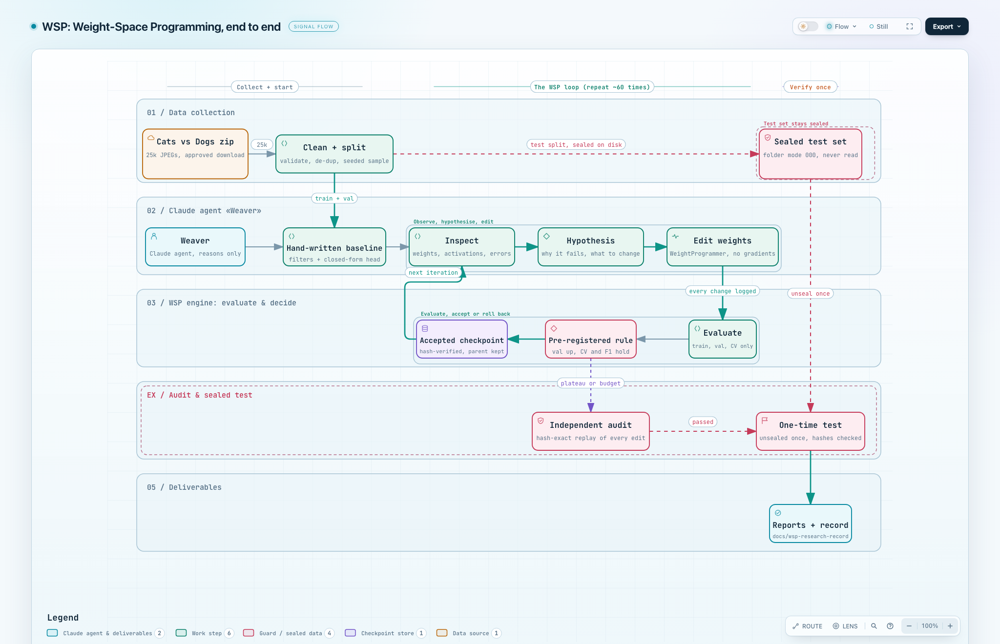

# Weight-Space Programming (WSP)

**Question:** can an LLM agent build and improve a cat-vs-dog image classifier by *reasoning about
and directly editing its weights*, with **no gradient-based training** (no backprop, optimizer,
fine-tuning, pretrained weights, or random search)?

## Actual result (the short, honest version)

| Experiment | Data (train / val / test) | Network | Sealed-test accuracy | Verdict |
|---|---|---|---|---|
| WSP-001 | 12 / 4 / 4 | 16/32/32 | 2/4 → 3/4 | Too small to mean anything |
| WSP-002 | 1,000 / 600 / 2,000 | 16/32/32 | 62.2% → 61.6% | No real gain |
| **WSP-003** | 8,000 / 3,000 / 6,000 | 16/32/32 | **60.7% → 77.1%** | Real gain, but see below |
| **WSP-004** | 8,000 / 3,000 / 3,884 fresh | wide 48/96/96 | **78.0%** (95% CI 76.7–79.3) | WSP-003 model scores 76.7% on the same images |

*Test = a held-out split that is sealed (folder mode 000) and read exactly once per experiment.*

**What the 77% is made of (WSP-003):**
- about **+14 pt** comes from a **closed-form, data-fitted classifier head** (linear discriminant). That is fitting to data, not hand programming.
- about **+2 to 3 pt** comes from the agent's reasoned weight edits.
- hand-built filters beat random filters by about **3 to 5 pt** (random filters + same head: 71.2%).

**So:** yes, partly. A hand-programmed network plus a closed-form head reaches about 77 to 78% on
unseen images. Most of the gain is data fitting; the agent's own edits add a small, real amount.
**100% is not reachable with this approach**, and this is not evidence of general visual classification.

## How it works (end to end)



Interactive version: [`docs/wsp-end-to-end-flow.html`](docs/wsp-end-to-end-flow.html) (download and open in a browser).

1. **Data:** Cats vs Dogs images are cleaned and split. The test split is sealed on disk.
2. **Baseline:** the agent (**Weaver**) hand-writes filters (Gabor, DoG, colour-opponent) and a closed-form head.
3. **The loop** (about 60 iterations over four experiments): inspect weights, activations and errors → write a hypothesis → edit weights through `WeightProgrammer` → evaluate on train/val/CV only → apply a **pre-registered accept/reject rule** → keep the checkpoint or roll back → repeat.
4. **Audit:** an independent audit replays every edit and checks the hashes.
5. **One-time test:** the sealed set is unsealed once, hash-checked, and scored. Reports follow.

## Why you can trust the process

- Every weight edit goes through `src/weight_programmer.py` and is logged with a hypothesis, old/new values, metrics and a decision.
- Accept rule (WSP-002 to 004): validation accuracy up by 1 pt or more, 5-fold CV not down more than 1 pt, F1 not down more than 1 pt. Training accuracy is never used.
- Automated audit (`src/weight_audit.py`): static AST scan, runtime checks (grad off, no optimizers), hash-exact replay of all iterations. **All four audits passed**, and four independent sub-agent reviews found no violations.
- Earlier experiments' files are read-only and hash-protected (190 hashes verified unchanged).

## Limitations and disclosures

- One dataset (Microsoft Cats vs Dogs web photos), 64×64 input, one split seed per experiment.
- WSP-001 and WSP-002 sample sizes were too small to show improvement. The "gains" there were noise.
- Validation data was reused across WSP-003/004, so selection bias accumulates. Only each experiment's sealed test is unbiased.
- A few WSP-002/003 iterations were written after the test aggregate was known; they are labelled exploratory and changed no accepted checkpoint.
- Agent model was Claude Sonnet 5.5 (the task text asked for Opus 5.5). Four approved dataset downloads were made, although the project `CLAUDE.md` says no downloads.
- Full list: [`docs/wsp-research-record/06_DEVIATIONS_MISTAKES_AND_DISCLOSURES.md`](docs/wsp-research-record/06_DEVIATIONS_MISTAKES_AND_DISCLOSURES.md).

## Read more

| File | Contents |
|---|---|
| [`docs/index.html`](docs/index.html) | Landing page |
| [`docs/wsp-research-record/`](docs/wsp-research-record/README.md) | Full record: method, observations, audit, ledger of every iteration, file map |
| `reports/WSP_00{2,3,4}_FINAL_REPORT.md`, `reports/FINAL_REPORT.md` | Per-experiment final reports |

## Repository layout

```
src/model.py              CatDogNet (autograd disabled, params requires_grad=False)
src/init_weights.py       hand-programmed filters; closed-form head rules
src/weight_programmer.py  the only interface for editing weights (logged)
src/wsp_engine.py         transactional iteration: edit -> validate -> evaluate -> accept/rollback
src/iterations*.py        the agent's hypotheses and explicit edits (append-only)
src/evaluator.py          metrics, CV / leave-one-out diagnostics
src/experiment_runner.py  CLI: init | run | status | final (resumable, network blocked)
src/weight_audit.py       static + runtime + replay audit
src/controls*.py          random-feature and label-shuffle controls
experiments/ checkpoints/ logs/ reports/   state, history, diffs, checkpoints, reports
```
The image dataset (2 GB) and most checkpoints are not in git. They must be rebuilt locally.

## Reproduce

```bash
uv sync
WSP_EXPERIMENT=wsp-003 uv run python src/experiment_runner.py status
WSP_EXPERIMENT=wsp-003 uv run python src/weight_audit.py --no-write    # audit, read-only
uv run python scripts/build_research_record.py                          # regenerate docs tables
```
`final` (sealed test) runs once per experiment and is already done for WSP-001 to 004. The dataset
must be rebuilt first (`src/dataset_wsp002.py`), which needs the Cats vs Dogs zip.
